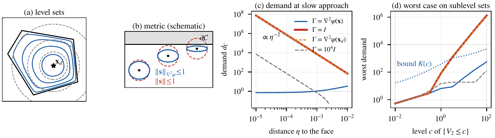
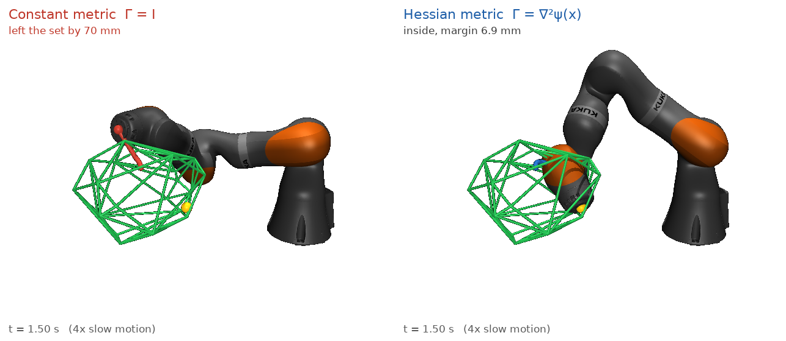

# Bregman Control Lyapunov Functions

### Hessian-Metric Backstepping for Convex State Constraints

**[Project page](https://domrachev03.github.io/bregman-clf)** ·
**[Paper (PDF)](https://domrachev03.github.io/bregman-clf/static/paper.pdf)** ·
**[Interactive demo](https://domrachev03.github.io/bregman-clf/demo/)** ·
**[Videos](https://domrachev03.github.io/bregman-clf/#results)**

[](https://domrachev03.github.io/bregman-clf)

[](https://domrachev03.github.io/bregman-clf)

A Bregman divergence of a barrier-type convex function is a control Lyapunov function whose sublevel
sets lie inside the constraint set, so one Lyapunov constraint certifies convergence and safety. At
relative degree two, the metric that weights the velocity error in backstepping decides whether the
acceleration this constraint needs stays bounded up to the boundary: with the Hessian of the
generating function it does (top right, blue); with any constant metric it grows like the inverse
squared distance to a face. Bottom: the same simulated arm, start and target with a constant metric
(left the set by 70 mm) and with the Hessian metric (inside).

This repository holds the code for the numerical results of the paper.

The repository contains

- `cvxlbs`: a small library that builds inverse-dynamics QP controllers from certificates written
  as CasADi expressions. The core is the order-two Bregman CLF
  (`src/cvxlbs/certificates/bregman.py`): the rate constraint of
  `V2 = D_psi(x_d, x) + 1/2 s^T Gamma s` with the backstepping metric `Gamma` equal to the Hessian
  of `psi` at the current point (proposed), the identity, or the Hessian at the target.
- `cvxlbs_playground`: the MuJoCo simulation of a torque-controlled KUKA iiwa 14, the scenarios,
  the controllers (ours and the per-face CBF baselines), and the sweep runner.
- `experiments/`: the scripts and configurations of every experiment reported in the paper.
- `results/`: the result files the numbers, tables and figures of the paper were generated from
  (the `.tex` fragments named below are written by the report scripts and are not tracked).

## Install

Linux x86-64, [pixi](https://pixi.sh):

```
pixi install
pixi run reference-wheels
```

The second command downloads the PyPI wheels of numpy 2.4.6 and scipy 1.18.0 into
`.reference-wheels/`, which the environment puts on `PYTHONPATH`. The stored results were produced
with these builds (bundled OpenBLAS 0.3.31). With them, the simulations below reproduce the stored
episode logs bit for bit on the machine used for the paper (Intel i5-14600KF); the closed loops of
the constant metrics near the boundary are sensitive to the last digit, so with another BLAS build
or CPU type individual trials can differ. Without the second command the conda-forge builds are
used and everything still runs.

The first manipulator run downloads the iiwa 14 model of MuJoCo Menagerie through
`robot_descriptions` (to `~/.cache/robot_descriptions`). No GPU is needed. `timing.py` needs `gcc`.

## Experiments

Run all commands from the repository root. Times are wall times on a 20-thread desktop CPU.

### Double integrator (Sec. VI-A)

Plain numpy/scipy scripts in `experiments/double_integrator/`; they read and write
`results/double_integrator/`.

| Command (`pixi run python experiments/double_integrator/...`) | Processes, time | Output | Used for |
|---|---|---|---|
| `dint_study.py demand` | 1, 1 min | `dint_demand.json` | worst demand on sublevel sets (Fig. 1d, text) |
| `dint_study.py demand_scaled` | 1, 20 s | `dint_demand_scaled.json` | same for `Gamma = 1e2 I, 1e4 I` |
| `dint_study.py loop` | 9, 5 min | `dint_closed_loop_mu0.01.json` | Table I, `a_max = 10, 30, 100` |
| `dint_study.py loop_high` | 6, 5 min | `..._high.json` | Table I, `a_max = 1000, 3000` |
| `dint_study.py loop_scaled` | 6, 3 min | `..._scaled.json` | Table I, scaled metrics |
| `dint_study.py loop_scaled_high` | 4, 3 min | `..._scaled_high.json` | Table I, scaled metrics |
| `dint_study.py loop_dt` | 2, 15 min | `..._scaled_dt5e-5.json` | finer integration step (not quoted in the paper) |
| `dint_recover.py` | 1, 1 s | `dint_recover.json` | recoverability of the starts |
| `dint_sampling.py` | 10, 20 min | `dint_sampling.json` | sampling-period sweep |
| `dint_braking.py` | 5, 2 min | `dint_braking.json` | braking-aware per-face CBF baseline |
| `dint_estcert.py` | 16, 5 min | `dint_estcert.json` | estimated certificates (Table I, last row) |
| `dint_report.py` | 1, 2 s | `dint_loop.tex`, `dint_numbers.tex`, `dint_demand.pdf` | Table I and the numbers in the text |
| `fig_concept.py` | 1, 2 s | `fig_concept.pdf`, `.png` | Fig. 1 |

`dint_recover.py`, `dint_report.py` and `fig_concept.py` only read stored results, so they can be
run directly.

### Manipulator (Sec. VI-B)

A sweep runs every (scenario, method, seed) of a configuration in parallel and writes the episode
logs and `summary.parquet` to `runs/<name>/` (not tracked, 1.8 GB for the three sweeps; an interrupted
sweep resumes):

```
pixi run python -m cvxlbs_playground.experiments.sweep experiments/manipulator/configs/<name>.yaml --workers 12
```

| Configuration | Episodes | Time (12 workers) | Content |
|---|---|---|---|
| `metric_study.yaml` | 2160 | 6 min | three metrics, rate and level constraint, 9 conditions (Table II) |
| `cbf_comparison.yaml` | 480 | 1 min | ours against per-face CBF QPs, 4 scenarios |
| `stress_test.yaml` | 200 | 1 min | exploratory stress test, 5 cells |

The gains in `cbf_comparison.yaml` and `stress_test.yaml` come from one tuning protocol applied to
every method and are fixed in the files.

Analysis scripts (`pixi run python experiments/manipulator/...`), writing to `results/manipulator/`:

| Script | Input | Output | Used for |
|---|---|---|---|
| `metric_study_table.py` (1 min) | episode logs in `runs/metric_study` | `metric_study_table.tex`, `.json`, `.parquet` | Table II |
| `metric_study_demand.py` (16 processes, 1 min) | episode logs in `runs/metric_study` | `metric_study_demand.json` | demand on logged states |
| `metric_study_numbers.py` | the two outputs above | `metric_study_numbers.tex` | numbers in the text |
| `cbf_comparison_stats.py` | summary | `cbf_comparison_stats.json`, `cbf_comparison_numbers.tex` | comparison with per-face CBF QPs |
| `stress_test_table.py` | summary | `stress_test_table.csv` | stress test |
| `timing.py` | none (runs 3 methods, 3 seeds, 3 repeats; under 1 min) | `timing.json` | control-step time |

The scripts that take a summary use `runs/<name>/summary.parquet` if a sweep has been run and the
stored `results/manipulator/<name>_summary.parquet` otherwise, so the last three statistics
scripts and `metric_study_numbers.py` work without running any simulation. Run `timing.py` pinned
to an idle core, e.g. `taskset -c 2 pixi run python experiments/manipulator/timing.py`.

Scenario names in the configurations and result files: `iiwa_e1_<psi>[_sat|_near]` (metric study:
polytope, ellipsoid or entropic box; nominal, 30 % torque bounds, or near-boundary start),
`iiwa_constraints_<variant>` (comparison), `iiwa_e8_pilot_<set>_t<torque %>_v<speed range>` (stress
test). Method labels: `bs_<metric>_<hard|level>` with metric `constant` (`Gamma = I`), `target`
(`Hess psi(x_d)`) or `hessian` (`Hess psi(x)`); `bregman_id_level` / `bregman_id_hard` (ours with
the level / rate constraint); `clf_aecbf` (relaxed CLF with one exponential CBF per face);
`tsid_cbf` (inverse dynamics with per-face CBFs); `tsid` (inverse dynamics without keep-in rows).

## Layout

```
src/cvxlbs/                    library
  psi.py                       generating functions, Bregman divergence
  certificates/bregman.py      Bregman CLF with backstepping (metric: hessian | constant | target)
  certificates/viability.py    braking-aware joint-position limits
  certificates/limits.py       one-step joint velocity / position rows
  certificates/baselines.py    exponential CBF rows, RES-CLF
  costs.py, tasks.py, model.py cost terms, task maps, Pinocchio model
  context.py, problem.py       symbolic context, QP assembly
  solver.py, controller.py     DAQP backend, controller with fallback law
  codegen.py                   optional C code generation of the QP data
src/cvxlbs_playground/
  robots/, sim.py              iiwa 14 loading (torque-mode MJCF), MuJoCo simulation
  scenarios.py                 keep-in sets, sampling of starts and targets
  methods/                     ours.py (proposed controller), baselines.py, registry.py
  experiments/                 runner.py, sweep.py, logs.py, metrics.py
experiments/double_integrator/ scripts of Sec. VI-A
experiments/manipulator/       sweep configurations and analysis scripts of Sec. VI-B
results/                       stored results
```

## Notes

- `docs/` holds the project page (GitHub Pages). `docs/demo/` is the browser demo: a JavaScript port of the
  controller (`controller.js`) on MuJoCo compiled to WebAssembly. `docs/demo/model/` contains the KUKA iiwa 14
  model of MuJoCo Menagerie under its own license (`docs/demo/model/LICENSE`).
- A large language model assistant was used to help implement the experiments; the authors reviewed the code and results.
